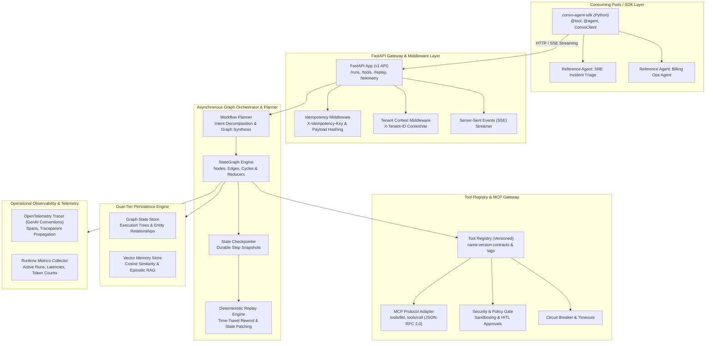

# 🚀 CONVO Agent Platform (`convo-agent-platform`)

<p align="center">
  
  
  
  
  
  
</p>

> **Enterprise Shared Runtime, Graph Orchestration, MCP Tool Registry & SDK for Agentic Applications**  
> *Engineered to satisfy all technical deliverables and acceptance criteria for CONVO's Senior Software Engineer - Python (Agentic Platform) role.*

---

## 📋 Executive Overview & Technical Mission

Modern agent platforms cannot rely on basic script loops or brittle LLM wrappers. The **CONVO Agent Platform** provides an enterprise-grade, asynchronous, multi-tenant foundation that enables product engineering pods to rapidly build, operate, and observe reliable domain agents.

### Architectural Blueprint



---

## 🌟 Core Platform Capabilities

### 1. Asynchronous Graph Orchestrator (`convo_runtime.core`)
- **StateGraph Engine**: Cyclical and acyclic execution graphs with coroutine node handlers and conditional routers.
- **Immutable State & Reducers**: State is isolated per node; state deltas are merged cleanly via snapshot reducers.
- **Durable Checkpointing**: Automatic snapshot generation at each execution step, stored in memory or durable SQLite/PostgreSQL.
- **Human-In-The-Loop (HITL) Pause/Resume**: When sensitive tools are invoked, the graph enters `workflow_paused` and saves its snapshot, resuming deterministically once approved.

### 2. Deterministic Replay Engine (`convo_runtime.core.replay`)
- **Time-Travel Debugging**: Load any historical `run_id` and step index `k`, reconstruct the graph state, and re-run execution forward.
- **State Injection / Patching**: Supply `state_overrides` to inject fixed configurations or mocked responses to verify bug fixes and disaster recovery procedures.

### 3. Model Context Protocol (MCP) Tool Registry (`convo_registry`)
- **MCP Native**: Implements standard JSON-RPC 2.0 `tools/list` and `tools/call` envelopes.
- **Contract Versioning**: Explicit semver contracts (`name:version`) with Pydantic v2 JSON Schema generation.
- **Security Sandboxing**: Injection detection, parameter validation, and tenant tool allowlists.
- **HITL Policy Enforcement**: Sensitive tools (`requires_approval=True`) automatically generate cryptographically tracked approval tokens.

### 4. Dual-Tier Persistence Layer (`convo_runtime.persistence`)
- **Graph Store**: Records execution state machines (`AgentRun -> INITIALIZED_WITH -> ExecutionStep -> TRANSITIONED_TO -> ExecutionStep`) and entity graphs. Supports multi-hop connected subgraph traversal.
- **Vector Memory Store**: Indexes episodic memories with cosine similarity scoring, metadata filtering, and semantic RAG recall.

### 5. Distributed Systems Reliability Core (`convo_runtime.reliability`)
- **Idempotency Manager**: Enforces at-most-once execution on mutating requests using `X-Idempotency-Key` and SHA-256 payload hashing. Cached responses are served instantly.
- **State-Aware Circuit Breaker**: Wraps tool executions and LLM calls in `CLOSED`, `OPEN`, and `HALF_OPEN` states to isolate downstream outages.
- **Exponential Backoff with Jitter**: Protects against thundering herd retry storms.
- **Execution Timeouts**: Async cancellation tokens prevent hanging processes.

### 6. Operational Telemetry & Observability (`convo_runtime.telemetry`)
- **OpenTelemetry GenAI Semantic Conventions**: Emits spans tagged with `gen_ai.system`, `convo.run_id`, `tool.name`, `tool.call_id`, `duration_ms`.
- **Trace Context Propagation**: Automatically injects and extracts `traceparent` headers across boundaries.
- **Real-Time Metrics**: Tracks active runs, latency percentiles, tool failure rates, and token spend.

### 7. Developer SDK (`convo_sdk`)
- **Consumable Python Client**: Fluent `ConvoClient` with namespaces for `.runs`, `.tools`, `.memory`, and `.telemetry`.
- **Zero-Boilerplate Decorators**: `@tool` automatically infers JSON Schema types from Python type annotations.
- **Event Streaming**: SSE async generator parsing live events (`WorkflowStarted`, `NodeStarted`, `NodeFinished`, `WorkflowCompleted`, `WorkflowPaused`).

---

## 📂 Repository Structure

```text
convo-agent-platform/
├── convo_runtime/                 # Shared Async Runtime & Orchestration Engine
│   ├── api/                       # FastAPI routes, middleware, and app factory
│   ├── core/                      # StateGraph, Checkpointer, Replay, and Planner
│   ├── persistence/               # GraphStore and VectorMemoryStore
│   ├── reliability/               # CircuitBreakers, Idempotency, Retries, Timeouts
│   └── telemetry/                 # OpenTelemetry GenAI spans and Metrics collector
│
├── convo_registry/                # Tool Registry & MCP Gateway
│   ├── contracts.py               # Pydantic v2 schemas and JSON-RPC envelopes
│   ├── mcp_adapter.py             # Model Context Protocol client & server adapters
│   ├── policy.py                  # Sandboxing and HITL authorization engine
│   ├── registry.py                # Versioned tool registry and execution dispatcher
│   └── builtin_tools.py           # Standard SRE and Billing tools
│
├── convo_sdk/                     # Consumable Python SDK
│   ├── client.py                  # Async ConvoClient with connection pooling
│   ├── decorators.py              # @tool and @agent decorators
│   ├── models.py                  # Typed request/response models
│   ├── streaming.py               # Server-Sent Events (SSE) parser
│   └── exceptions.py              # Structured SDK exceptions
│
├── examples/                      # Reference Domain Agents
│   ├── sre_incident_triage/       # Reference Agent 1: Cloud SRE Incident Agent
│   └── billing_ops_agent/         # Reference Agent 2: Customer Billing Dispute Agent
│
├── tests/                         # Production-grade pytest suite (26 passing tests)
├── docs/                          # Architecture, SDK guide, and MCP specification
├── cli.py                         # Interactive platform CLI
├── Dockerfile                     # Production container image
└── pyproject.toml                 # Package configuration
```

---

## ⚡ Quickstart

### 1. Run Automated Test Suite

```bash
python -m pytest -v
```

Output:
```text
============================= 26 passed in 1.34s ==============================
```

### 2. Interactive CLI Commands

```bash
# List registered tools in registry
python cli.py tools

# Execute an agent workflow with live event streaming
python cli.py stream "Analyze cluster resource trends"

# Inspect platform telemetry and operational metrics
python cli.py telemetry
```

### 3. Run Reference Domain Agents

```bash
# 1. Run Cloud SRE Incident Triage Agent (Demonstrates HITL approval)
python examples/sre_incident_triage/run.py

# 2. Run Billing Operations Dispute Agent (Demonstrates vector memory & idempotency)
python examples/billing_ops_agent/run.py
```

---

## 🛡️ Deliverables vs. CONVO Job Requirements

| JD Requirement | Implementation Evidence |
| :--- | :--- |
| **Shared runtime and graph orchestration** | `convo_runtime.core.graph.StateGraph`, `CompiledGraph`, and `convo_runtime.api.app`. |
| **Tool registry and MCP contract layer** | `convo_registry.registry.ToolRegistry` and `convo_registry.mcp_adapter.MCPProtocolAdapter`. |
| **Graph and vector persistence** | `convo_runtime.persistence.graph_store.GraphStore` and `vector_store.VectorMemoryStore`. |
| **Failure handling, retries, idempotency, timeouts** | `convo_runtime.reliability` (`CircuitBreaker`, `IdempotencyManager`, `retry_async`, `run_with_timeout`). |
| **Deterministic replay** | `convo_runtime.core.replay.DeterministicReplayEngine` with historical checkpoint rewind. |
| **Developer SDK & reference implementations** | `convo_sdk` package + `examples/sre_incident_triage/` and `examples/billing_ops_agent/`. |
| **OpenTelemetry tracing & operational telemetry** | `convo_runtime.telemetry` (`trace_workflow_span`, `RuntimeMetricsCollector`). |
