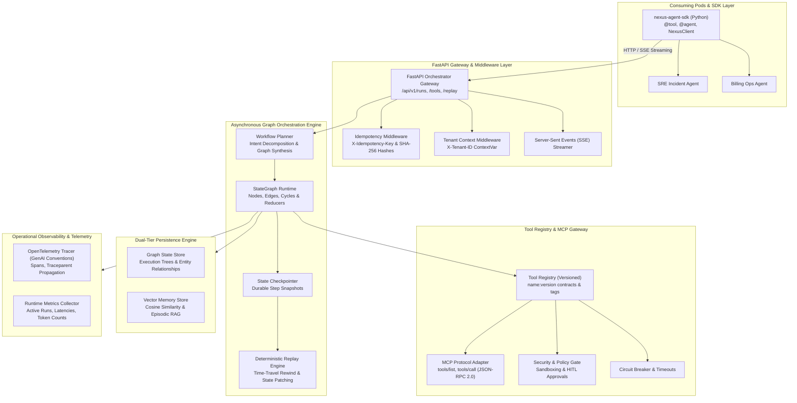

# NEXUS Agent Platform — Technical Architecture Specification

## 1. Executive Summary & Mission

The **NEXUS Agent Platform (`nexus-agent-runtime`)** is the shared runtime, orchestration engine, tool registry, and developer SDK powering domain-specific agents across internal engineering pods.

Rather than building one-off, brittle LLM scripts, this platform provides an **enterprise-grade, multi-tenant agent execution platform** that guarantees:
- **Asynchronous, stateful graph execution** with cycles, conditional branching, and checkpointing.
- **Strict Model Context Protocol (MCP)** compliance and dynamic tool contracts.
- **Dual-tier persistence**: Directed graph stores for execution dependency trees + Vector stores for semantic episodic memory.
- **Distributed systems resilience**: Idempotency keys (`X-Idempotency-Key`), state-machine circuit breakers, full-jitter exponential retries, and cancellation timeouts.
- **Deep observability**: OpenTelemetry tracing adhering to GenAI semantic conventions, traceparent propagation, and metric counters.
- **Developer-friendly SDK**: Strongly-typed Python SDK with Server-Sent Events (SSE) streaming and `@tool`/`@agent` decorators.

---

## 2. High-Level Architecture

---

## 3. Core Subsystems

### 3.1 Asynchronous Graph Orchestrator (`nexus_runtime.core`)
- **StateGraph**: Models agent workflows as directed cyclical or acyclic graphs.
- **Nodes & Edges**: Supports asynchronous coroutine handlers and synchronous callables. Edges can be static or conditional (evaluated by router functions).
- **Cycle Control**: Built-in maximum loop iteration thresholds prevent runaway execution loops.
- **State Snapshots & Reducers**: State is represented via `AgentState`. At every node transition, an immutable `StateSnapshot` is persisted by the checkpointer.
- **Human-in-the-Loop (HITL) Pause/Resume**: If a sensitive action is detected, the graph sets `__pause_requested__` and yields a `workflow_paused` event, saving its exact checkpoint. Once approved, it can be deterministically resumed.

### 3.2 Deterministic Replay Engine (`nexus_runtime.core.replay`)
- **Time-Travel Debugging**: Allows an engineer to inspect any historical `run_id`, fetch state checkpoints, and rewind execution to any step index `k`.
- **State Injection & Patching**: Operators can pass `state_overrides` (e.g. patched parameters or mocked downstream responses) to reproduce edge cases or verify bug fixes without repeating non-faulty side-effects.

### 3.3 Tool Registry & MCP Adapter (`nexus_registry`)
- **Model Context Protocol (MCP)**: Native compliance with the official Anthropic/Open MCP standard.
- **Bi-directional Integration**:
  - Exposes internal Nexus tools to external MCP clients (Claude Desktop, Cursor) via `/api/v1/tools/mcp/rpc`.
  - Ingests external MCP servers via `ExternalMCPClientAdapter`.
- **Contract Versioning**: Tools are registered with semver tags (e.g., `1.0.0`), allowing breaking changes to be versioned safely.
- **Security & Sandboxing**: Parameter validation against JSON Schema, shell-injection guardrails, and tenant allowlists.

### 3.4 Dual-Tier Persistence Layer (`nexus_runtime.persistence`)
- **Graph Store (`GraphStore`)**: Represents entity graphs (services, pods, alerts, customers) and workflow execution trees (`AgentRun -> INITIALIZED_WITH -> ExecutionStep -> TRANSITIONED_TO -> ExecutionStep`). Supports multi-hop connected subgraph traversals.
- **Vector Store (`VectorMemoryStore`)**: In-memory and persistent vector index with cosine similarity, metadata filtering, and episodic memory persistence (`record_episodic_memory`).

### 3.5 Distributed Resilience & Reliability (`nexus_runtime.reliability`)
- **Idempotency Manager**: Prevents duplicate executions of mutating operations. Generates cryptographic hashes of payloads and leases keys. Completed runs return cached responses (`X-Cache-Lookup: HIT-IDEMPOTENCY`). Conflicting payloads trigger `IdempotencyConflictError`.
- **Circuit Breaker**: Three-state machine (`CLOSED`, `OPEN`, `HALF_OPEN`) wrapped around downstream tools and LLMs. Trips upon reaching failure thresholds and allows gradual probe requests after a recovery timeout.
- **Exponential Backoff with Full Jitter**: Mitigates thundering herd problems on retries.
- **Timeouts & Cancellation**: Async timeout guards ensure misbehaving external dependencies are cancelled cleanly.

### 3.6 Observability & Telemetry (`nexus_runtime.telemetry`)
- **OpenTelemetry GenAI Conventions**: Injects attributes:
  - `gen_ai.system: "nexus_agent_runtime"`
  - `nexus.run_id`, `nexus.tenant_id`
  - `tool.name`, `tool.call_id`, `tool.parameters`
- **Context Propagation**: Automatic `traceparent` injection into outbound headers.
- **Metrics Collector**: Aggregates total runs, active runs, failure rates, tool usage breakdowns, token spend, and latency percentiles.

---

## 4. NEXUS Deliverables & Acceptance Criteria Alignment

| NEXUS JD Deliverable | Implementation in Platform | Verification |
| :--- | :--- | :--- |
| **Versioned agent runtime and orchestrator services** | FastAPI asynchronous runtime (`nexus_runtime.api`) and `StateGraph` engine (`nexus_runtime.core`). | `tests/test_graph_orchestrator.py` |
| **Tool registry and MCP-compatible contract layer** | `ToolRegistry` with Pydantic v2 schemas and JSON-RPC 2.0 MCP adapter (`nexus_registry`). | `tests/test_mcp_registry.py` |
| **Documented agent SDK with reference agents** | `nexus_sdk` package with `@tool`/`@agent` decorators and 2 reference domain agents (`sre_incident_triage` & `billing_ops_agent`). | `tests/test_sdk_integration.py` |
| **Operational telemetry and failure-management** | OpenTelemetry GenAI spans, metrics collector, idempotency middleware, and circuit breakers. | `tests/test_telemetry.py`, `tests/test_reliability.py` |
| **Deterministic replay** | `DeterministicReplayEngine` rewinding to historical checkpoint indices with state patching. | `tests/test_deterministic_replay.py` |
